  

<h2 align="center">Houssam Choubik</h2>

  Cybersecurity &amp; Cloud Computing engineering student · ENSAM Casablanca 
  Securing the systems where AI, industry and health meet.

  
  

---

**Now** · Lead Organizer, GDG on Campus ENSAM Casablanca · building Smart Energy Guardian  
**Recently** · Cloud Security Intern (DevSecOps) at Dataprotect  
**Open to** · Summer 2027 internships, industry or research

#### Highlights

- 🌍 **Falling Walls Lab 2026**: Global Finalist in Berlin
- 🚩 **OlympICTs CTF 2026**: 1st worldwide in the qualifier
- 🏆 **AGIOS v2 2026**: 1st prize · **HackerRank Orchestrate**: 1st in Morocco
- 🛡️ **Fortinet NSE 4**

#### Projects

| | |
|---|---|
| ⚡ [**Smart Energy Guardian**](https://eneguardian.app) | AI + Industrial IoT predictive maintenance for factories |
| 📷 [**quickcam-messenger-win11**](https://github.com/H0ussamCl4p/quickcam-messenger-win11) | Rust WinUSB driver that revives an old webcam on Windows 11 |
| 🦀 [**HCShell**](https://github.com/H0ussamCl4p/HCShell) | Unix-like shell written in Rust |
| 🐧 [**MyDistro**](https://github.com/H0ussamCl4p/MyDistro) | Minimal Linux distribution built from scratch |

#### Stack

<i>"Be smart and protect every machine."</i>

